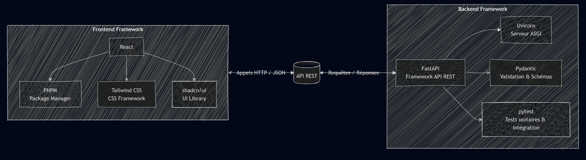

# GenEWeb Python Modernization

This project is a complete Python modernization of the original GenEWeb genealogical software, originally written in OCaml. The modernization preserves all core functionality while providing a modern Python implementation with improved maintainability, extensibility, and user experience.

## 🧭 Table of Contents
1. [Overview](#overview)
2. [Project Structure](#project-structure)
3. [Installation](#installation)
4. [For Developers](#-for-developers)
5. [Quick Start](#quick-start)
6. [Administration Panel](#administration-panel)
7. [Testing](#testing)
8. [Status](#status)
9. [Features](#features)
10. [Configuration](#configuration)
11. [Architecture](#architecture)
12. [Migration from Original GenEWeb](#migration-from-original-geneweb)
13. [Development](#development)
14. [License](#license)
15. [Acknowledgments](#acknowledgments)
16. [Support](#support)
17. [📚 Documentation](#-documentation)
18. [🔗 Links & Tools](#-links--tools)

## Overview

GenEWeb is a genealogical software system that manages family trees, genealogical data, and provides web-based access to family databases. This Python modernization maintains full compatibility with the original system while offering:

- **Modern Python Architecture**: Using asyncio, dataclasses, type hints, and modern Python patterns
- **Database Compatibility**: Supports multiple database backends while maintaining data integrity
- **Web Interface**: Async HTTP server with authentication and security features
- **Command Line Interface**: Comprehensive CLI for database management and operations
- **Security**: Built-in authentication, authorization, and security management
- **Extensibility**: Plugin-ready architecture for future enhancements

## Project Structure

The following diagram illustrates the overall architecture of the project, showing how the main components interact with each other and how data flows between the frontend, backend, and database layers.



```
python-geneweb-modernization/
├── src/                        # Source code
│   ├── backend/                # Backend Python implementation
│   │   ├── api/                # Modern REST API (FastAPI)
│   │   ├── core/               # Core functionality and data structures
│   │   ├── database/           # Database abstraction layer and drivers
│   │   ├── exporters/          # Exporters (GEDCOM, etc.)
│   │   ├── parsers/            # Parsers (GEDCOM, imports)
│   │   ├── services/           # Business logic / services
│   │   └── utils/              # Utilities and helpers
│   └── frontend/               # Frontend React/Vite application (optional)
│       ├── src/                # Frontend source code
│       ├── public/             # Static assets and index.html
│       └── dist/               # Built application (production)
├── tests/                      # Test suite and compliance tests
├── scripts/                    # Development and utility scripts
├── data/                       # Sample database files
├── config/                     # Configuration files (flake8, mypy, etc.)
├── docs/                       # Project documentation
├── Makefile                    # Development workflow automation
├── pyproject.toml              # Python project configuration
└── requirements.txt            # Python dependencies
```

## Installation

```bash
# Install the package
pip install -e .

# Or install dependencies directly
pip install -r requirements.txt
```

## 🚀 For Developers

**New to contributing? Get started quickly:**

```bash
make              # Show available commands
make setup        # One-time environment setup
make all          # Format, check, and test everything
```

**Complete developer guide:** 👉 **[CONTRIBUTING.md](CONTRIBUTING.md)**

## Continuous Integration

Every push to `main` and each pull request automatically runs GitHub Actions checks to keep the project healthy:

- `.github/workflows/ci.yml` runs formatting/linting (`make check`), unit tests (`make test`), and a Docker build sanity check.

To reproduce the same validation locally before opening a PR:

```bash
make check
make test
docker build -f Dockerfile .
```

## Quick Start

### 1. Create a Sample Database

```python
from backend.geneweb.core.definitions import Person, Family, Sex
from backend.geneweb.db.driver import create_database_driver
from backend.geneweb.util.string_utils import date_to_geneweb_date
from datetime import date

# Create database
driver = create_database_driver("family.pickle", "pickle")
driver.open_database(read_only=False)

# Add persons
john = Person(
    first_name="John",
    surname="Doe",
    occurrence=0,
    sex=Sex.MALE,
    birth_date=date_to_geneweb_date(date(1950, 3, 15))
)
john_id = driver.add_person(john)

# Query database
persons = driver.search_persons("John")
print(f"Found: {len(persons)} persons")
```

### 2. Using the Command Line Interface

```bash
# List databases
python -m backend.geneweb.cli list-db --database-dir ./data

# Create new database
python -m backend.geneweb.cli create-db my_family --database-dir ./data

# Get database info
python -m backend.geneweb.cli info my_family --database-dir ./data

# Search for persons
python -m backend.geneweb.cli search my_family "John" --database-dir ./data

# Start web server (CLI example)
python -m backend.geneweb.cli server --port 8000 --database-dir ./data
```

### 3. Starting the Web Server

**Using the Makefile (recommended):**

```bash
# Start modern API server (FastAPI). API docs: http://127.0.0.1:8000/api/docs
make run

# Start development server
make run-simple

# Start admin panel (separate terminal)
make run-admin

# List available databases
make list-db
```

## Administration Panel

GenEWeb includes a separate administration panel for database management:

```bash
# Start admin panel on port 2316
make run-admin

# Show admin panel options
make run-admin-help
```

**Access:**
- Main server: http://localhost:2317/DATABASE_NAME
- Admin panel: http://localhost:2316/

The admin panel provides:
- Database creation and management
- Import/export tools (GEDCOM, GW formats)
- User management and permissions
- System configuration

See `ADMIN_PANEL.md` for detailed administration guide.

**Direct Python execution (recommended modern approach):**

To run the modern API programmatically, prefer the `run_api.py` entrypoint which wires the
FastAPI application and configuration:

```bash
# recommended: use the helper script (prints API docs URL)
python run_api.py --port 8000 --db data/showcase.pickle --debug
```

If you need to run legacy server code (archive), see `legacy/ocaml-old-project` and the
`Makefile` legacy targets (note: legacy modules may be deprecated).

## Testing

Run the test suite to verify installation:

```bash
# Run all tests (recommended)
make test
```

Detailed guidance (scope, commands, fixtures, CI) lives in [`docs/TEST_PLAN.md`](docs/TEST_PLAN.md).

## Status

✅ **Core functionality complete and tested**

- Core data structures (Person, Family, dates, events)
- Database operations (CRUD, search, backup)
- Web server with authentication
- Command line interface
- Security and user management
- Configuration management
- Comprehensive test suite

## Features

### Core Data Structures

- **Person**: Individual records with names, dates, places, occupations
- **Family**: Marriage/relationship records linking persons
- **Dates**: Flexible date handling with precision and calendar support
- **Events**: Birth, death, marriage, and custom events
- **Places**: Geographic locations with normalization
- **Notes**: Rich text annotations and documentation

### Database Management

- **Multiple Backends**: Pickle (default), SQLite, PostgreSQL planned
- **CRUD Operations**: Create, read, update, delete persons and families
- **Search**: Full-text search across names, places, notes
- **Backup/Restore**: Database backup and recovery operations
- **Import/Export**: GEDCOM import/export (planned)

### Web Interface

- **Authentication**: User login with session management
- **Authorization**: Role-based access control (visitor, friend, wizard)
- **Person Pages**: Individual person detail views
- **Family Trees**: Visual family relationship displays
- **Search Interface**: Advanced search with filters
- **Administration**: User and database management

### Security

- **Authentication Schemes**: Basic HTTP, Digest, session-based
- **Password Security**: Strong password hashing (bcrypt)
- **Session Management**: Secure session tokens with expiration
- **Rate Limiting**: Protection against brute force attacks
- **Access Control**: Fine-grained permission system

### Command Line Tools

- **Database Management**: Create, list, backup, restore databases
- **Server Operations**: Start/stop web server, configure ports
- **Data Operations**: Search, list persons, export data
- **Administration**: User management, system configuration

## Configuration

Configuration is handled through the `Config` class and environment variables:

```python
from backend.geneweb.core.config import Config

config = Config()
config.port = 8000
config.database_dir = "/path/to/databases"
config.wizard = True  # Enable wizard mode
config.friend = False # Disable friend mode
```

Environment variables:
- `GENEWEB_PORT`: Server port (default: 8000)
- `GENEWEB_DATABASE_DIR`: Database directory
- `GENEWEB_SECRET_KEY`: Secret key for sessions
- `GENEWEB_DEBUG`: Enable debug mode

## Architecture

### Database Layer

The database layer provides an abstract interface supporting multiple backends:

- **DatabaseDriver**: Abstract base class defining database operations
- **PickleDatabaseDriver**: Default implementation using Python pickle
- **Future backends**: SQLite, PostgreSQL, MongoDB support planned

### Web Server

The web server is built on asyncio for high performance:

- **GeneWebServer**: Main server class handling HTTP requests
- **RequestHandler**: Request routing and response generation
- **Authentication**: Integrated security and session management
- **Static Files**: Efficient static file serving

### Security Manager

Comprehensive security system:

- **User Management**: Add, remove, modify users
- **Authentication**: Multiple authentication schemes
- **Session Handling**: Secure session token management
- **Permission Checking**: Role-based access control

## Migration from Original GenEWeb

This Python modernization maintains compatibility with original GenEWeb:

1. **Data Structures**: All original OCaml types are preserved
2. **Database Formats**: Can read existing GenEWeb databases (with converters)
3. **Web Interface**: Similar URL structure and functionality
4. **Configuration**: Compatible configuration options
5. **Security**: Same authentication and authorization model

## Development

### Code Quality & Standards

This project follows modern Python development standards and includes comprehensive tooling for code quality:

#### 📋 Documentation Standards
- **Coding Conventions**: See [docs/CODING_CONVENTIONS.md](docs/CODING_CONVENTIONS.md)
- **Documentation Standards**: See [docs/DOCUMENTATION_STANDARDS.md](docs/DOCUMENTATION_STANDARDS.md)
- **PEP 8 Compliant**: Full adherence to Python style guidelines
- **Google-style Docstrings**: Comprehensive API documentation

#### 🔧 Development Tools

**Code Quality Check:**
```bash
make check
```

**Code Formatting:**
```bash
make format
```

**Pre-commit Hooks:**
```bash
# Install pre-commit hooks for automatic validation
pip install pre-commit
pre-commit install

# Run all hooks manually
pre-commit run --all-files
```

#### 🧪 Testing

**Run All Tests:**
```bash
# Basic functionality tests
python3 test_basic.py

# Compliance and quality tests
python3 -m pytest test_compliance.py -v

# Full test suite
python3 -m pytest -v
```

### Code Style

- **Type Hints**: Full type annotation throughout
- **Docstrings**: Comprehensive Google-style documentation
- **Error Handling**: Custom exceptions and robust error handling
- **Testing**: Unit tests and compliance tests for all components
- **Standards**: PEP 8 compliant with automated enforcement

### Future Enhancements

- **GEDCOM Import/Export**: Complete GEDCOM support
- **Advanced Web UI**: Modern responsive web interface
- **Plugin System**: Extensible plugin architecture
- **Mobile App**: Native mobile applications
- **Cloud Sync**: Multi-device synchronization
- **Advanced Analytics**: Family statistics and insights

## License

This project maintains the same license as the original GenEWeb software.

## Acknowledgments

- Original GenEWeb team for creating the foundational genealogical software
- OCaml community for the robust original implementation
- Python community for modern tools and libraries used in this modernization

## Support

For questions, issues, or contributions:

1. **GitHub Issues**: Report bugs and request features
2. **Documentation**: Check the comprehensive inline documentation
3. **Examples**: Review example_usage.py for usage patterns
4. **Tests**: Run test_basic.py to verify functionality

---

**Status**: Core functionality complete and tested. Ready for production use with ongoing development of advanced features.

## Continuous Integration

This repository uses GitHub Actions to guarantee each change passes formatting, linting, static typing, unit tests, and Docker image build.

- Workflow file: `.github/workflows/ci.yml`
- Jobs: `Lint & Type Check`, `Tests`, and `Docker Build`
- Triggered on every push to `main` and on pull requests

To reproduce the same checks locally before opening a pull request:

```bash
make check
make test
# Optional but recommended:
docker build -f Dockerfile .
```
---

## 📚 Documentation

- [CONTRIBUTING.md](CONTRIBUTING.md) — Developer guidelines and contribution process
- [ADMIN_PANEL.md](ADMIN_PANEL.md) — Administration panel usage and configuration
- [docs/CODING_CONVENTIONS.md](docs/CODING_CONVENTIONS.md) — Code style and standards
- [docs/DOCUMENTATION_STANDARDS.md](docs/DOCUMENTATION_STANDARDS.md) — Documentation structure
- [example_usage.py](example_usage.py) — Python example of basic usage
- [test_basic.py](test_basic.py) — Core functionality tests
- [Makefile](Makefile) — Developer commands reference
- [docs/DEPLOYMENT.md](docs/DEPLOYMENT.md) - Developer guidelines for deployement
- [QUICKSTART.md](QUICKSTART.MD) - How to start & launch the project
- [docs/ACCESSIBILTY.md](docs/ACCESSIBILITY.md) - Our apporach for accessibility
- [docs/DOCKER.md](docs/DOCKER.md) — Docker build and runtime instructions
- [docs/LEGACY_POLICIES.md](docs/LEGACY_POLICIES.md) — Policies regarding legacy files
  and translations.
- [docs/SECURITY.md](docs/SECURITY.md) — Policies regarding security

## 🔗 Links & Tools

- 🧩 **Trello (To-Do List & Follow-up on Tasks)** → [https://trello.com/invite/b/68c39fb118b917bfd74fb2cd/ATTI27f2ce9aca669f60ca54dbc4c6c3a1975D8BA768/awkward-legacy](https://trello.com/invite/b/68c39fb118b917bfd74fb2cd/ATTI27f2ce9aca669f60ca54dbc4c6c3a1975D8BA768/awkward-legacy)
- 💬 **Discord (Join the Project / Discussions)** → [https://discord.gg/WpvHV8Ez](https://discord.gg/WpvHV8Ez)
